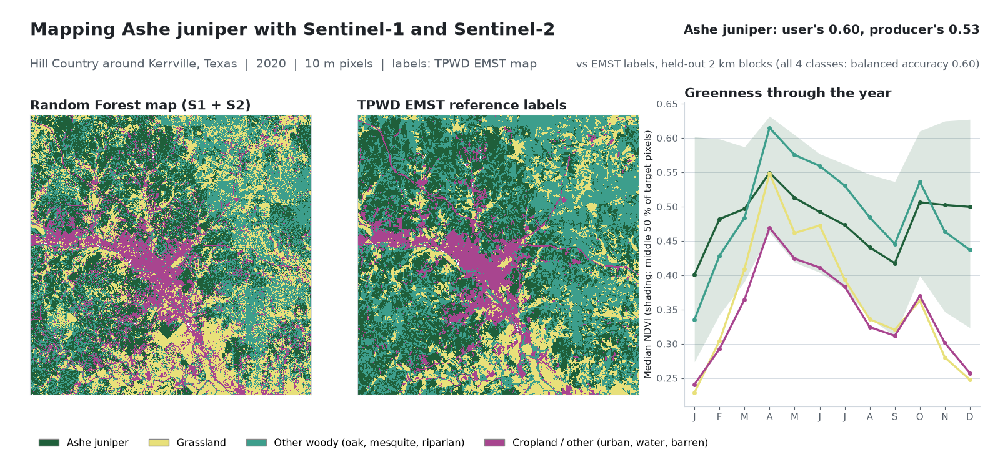
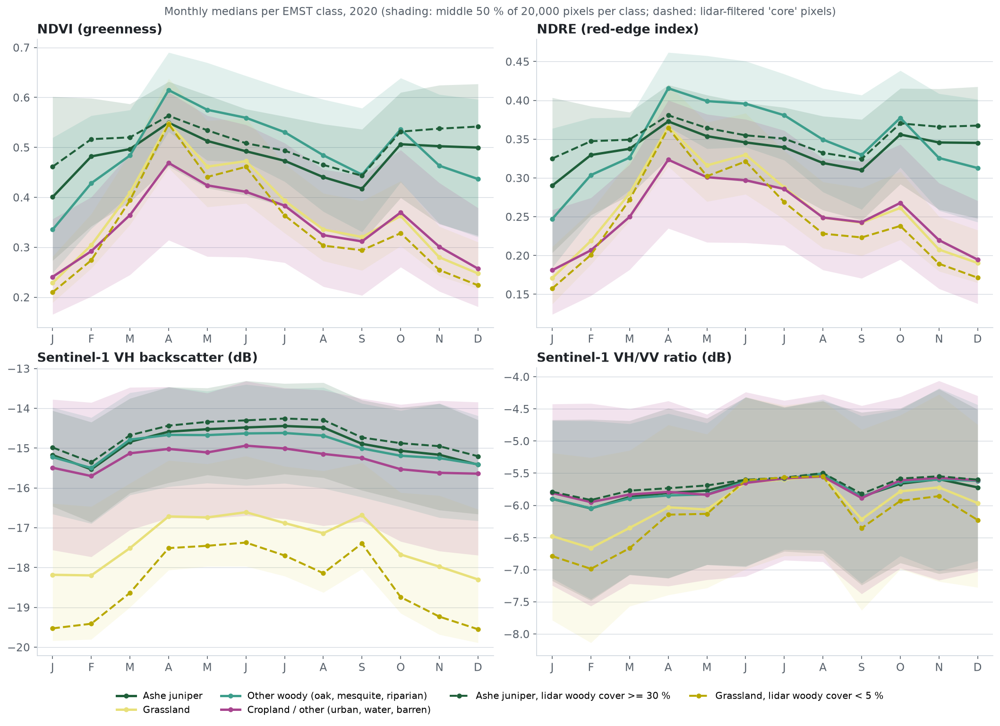
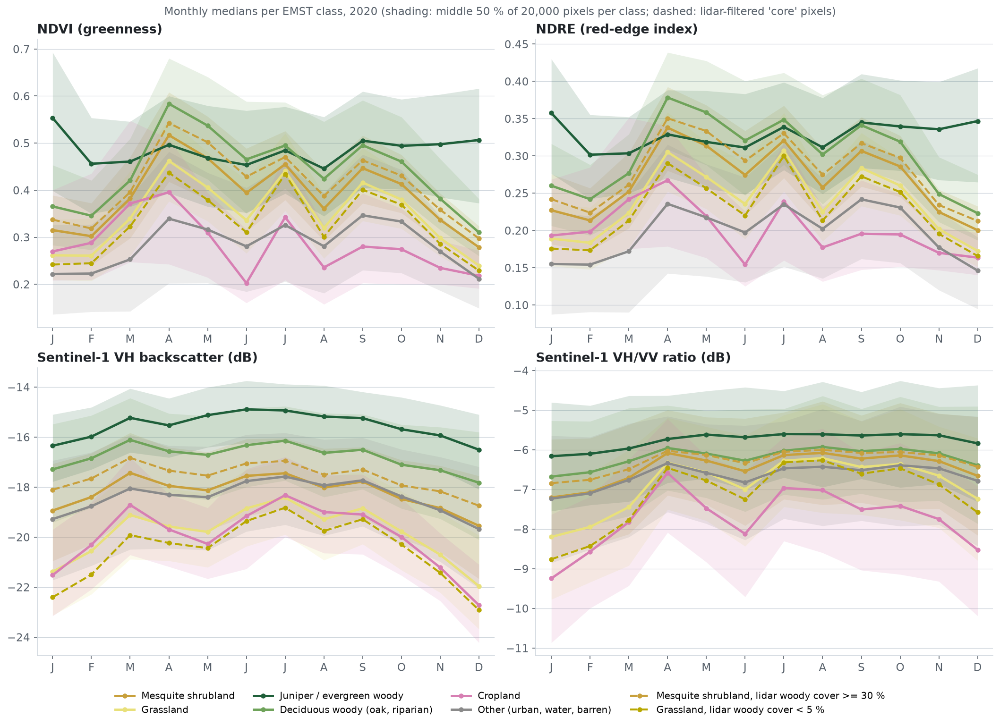
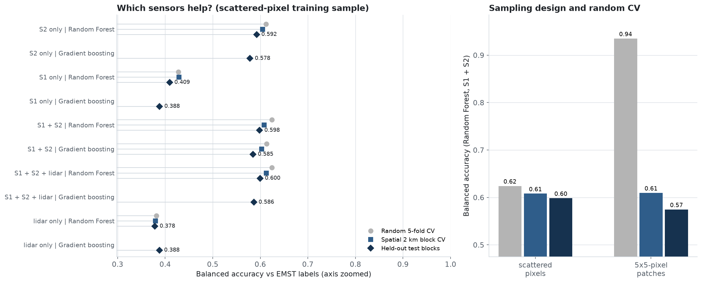
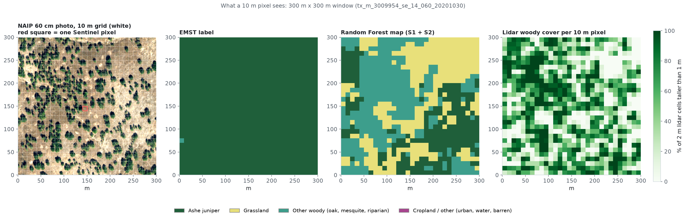

# What can a 10 m pixel see? Mapping Texas brush species with Sentinel-1, Sentinel-2 and lidar

This project asks how far free 10 m satellite data can go in mapping invasive and encroaching brush species. It maps two Texas species with one pipeline and one validation design: **Ashe juniper** (*Juniperus ashei*), an evergreen, in the Hill Country, and **honey mesquite** (*Prosopis glandulosa*), a winter-deciduous shrub, in the Rolling Plains. Each site is a 25 km box, mapped from a year of Sentinel-2 optical images, Sentinel-1 radar images and, as an extra test, airborne lidar height. Labels come from the Texas Parks and Wildlife Department's Ecological Mapping Systems of Texas (EMST) map, and whole 2 km blocks are held out for testing.

## Summary

- **Question:** Can a 10 m Sentinel-2 and Sentinel-1 pixel tell an encroaching brush species apart from the plants around it, when judged on held-out 2 km blocks?
- **Answer:** Only partly. Evergreen juniper is the easier case: in the Hill Country, Ashe juniper reached a user's accuracy of 0.60 ± 0.04 and a producer's accuracy of 0.53 ± 0.03 against the EMST map (0.65 and 0.56 with lidar added), and at the Rolling Plains site the juniper / evergreen class reached 0.78 and 0.81 next to plants that are leafless or dormant in winter. Winter-deciduous honey mesquite reached only 0.46 and 0.38. Sentinel-1 radar added at most 0.006 of balanced accuracy at either site.
- **Main limitation:** The labels are a map made from 2008 to 2013, not field checks, and many of its polygons mix species or include grass gaps (about half of the juniper area is "Ashe Juniper - Live Oak" types), so all numbers measure agreement with that map, for one year at two places.



## My role

I'm a geographer: B.S. in Geography with a GIS background, now an M.S. Geography student at Texas A&M. I ran this project as the human on the loop. I owned the question, the standards and every decision about what gets published, and used Claude Code (Anthropic) as the programmer.

- **Problem framing:** I defined the question, approved the study area and data, and set what a useful, defensible answer looks like.
- **Key call:** when honey mesquite proved too hard to separate at 10 m, I kept it as a reported limit and expanded the study to Ashe juniper, instead of dropping the result or stretching the claim.
- **Standards:** spatially held-out validation where the data allow, methods grounded in peer-reviewed literature, honest uncertainty (intervals and stated limitations), and a stated cost for every design choice.
- **Oversight at every stage:** I reviewed the plan, the intermediate results, the figures and the write-up, challenged anything unclear or unsupported, and sent work back until it met the standard.
- **Quality control:** before publishing, every number was traced to the project's results, the references checked and the tests run. The final call on what is reported, and what is stated as a limitation, is mine.

Commits made with Claude Code carry its `Co-Authored-By` line.

## Results

All numbers come from `python run.py --site juniper` and `python run.py --site mesquite` (seed 42). They are written to [`results/juniper/metrics.json`](results/juniper/metrics.json) and [`results/mesquite/metrics.json`](results/mesquite/metrics.json).

*User's accuracy* is the share of pixels mapped as a class that the reference also calls that class. *Producer's accuracy* is the share of the reference class that the map finds. *Balanced accuracy* is the mean of the producer's accuracies, so each class counts the same. All accuracies are agreement with the EMST labels on held-out blocks.

### The two sites side by side

| | Ashe juniper, Hill Country | Honey mesquite, Rolling Plains |
|---|---|---|
| Box (WGS 84) | -99.26 to -99.00 °E, 29.950 to 30.175 °N (around Kerrville) | -99.95 to -99.68 °E, 32.000 to 32.225 °N (about 25 km south of Abilene) |
| Size, pixels | 25.1 × 25.0 km, 2509 × 2497 at 10 m | 25.7 × 25.2 km, 2567 × 2515 at 10 m |
| Target class share | 33.0 % | 21.7 % |
| Target user's / producer's accuracy (S1 + S2) | **0.60 ± 0.04 / 0.53 ± 0.03** | **0.46 ± 0.04 / 0.38 ± 0.03** |
| Same, with lidar height added | 0.65 / 0.56 | 0.45 / 0.41 |
| Balanced accuracy, all classes (S1 + S2) | 0.598 (4 classes) | 0.600 (6 classes) |
| Main confusion of the target | other woody (live oak and other oaks) | deciduous woody and grassland |
| Target area in test blocks: mapped / estimated / EMST | 40.4 / 46.0 ± 2.6 / 45.5 km² | 25.5 / 30.7 ± 1.9 / 29.0 km² |

Random Forest, Sentinel-1 + Sentinel-2, 34 held-out 2 km blocks per site, area-weighted estimates with 95 % confidence intervals (Olofsson et al. 2014).

### Site 1: Ashe juniper in the Hill Country (where the satellites do best)

**Classes** (from EMST, share of the box): Ashe juniper 33.0 %, grassland 16.6 %, other woody (oak, mesquite, riparian) 39.4 %, cropland / other (urban, water, barren) 11.1 %. An EMST type counts as Ashe juniper when juniper is the first plant in its name. **The juniper class mixes in other evergreens:** "Ashe Juniper - Live Oak Shrubland" (13.4 % of the box) and "Ashe Juniper - Live Oak Slope Shrubland" (2.9 %) are juniper-led mixes with live oak, about half of the class. Live oak itself ("Live Oak Motte and Woodland", 11.8 %) and oak-led mixes such as "Oak / Ashe Juniper Slope Forest" (3.5 %) are in other woody. The box was chosen to have plenty of both juniper and oak, so this is a hard test.

| Class | User's accuracy (± 95 % CI) | Producer's accuracy (± 95 % CI) | Mapped km² | Estimated km² (± 95 % CI) | EMST census km² |
|---|---|---|---|---|---|
| **Ashe juniper** | **0.60 ± 0.04** | **0.53 ± 0.03** | 40.38 | 45.97 ± 2.64 | 45.50 |
| Grassland | 0.38 ± 0.04 | 0.67 ± 0.05 | 27.59 | 15.59 ± 1.63 | 16.38 |
| Other woody (oak, mesquite, riparian) | 0.71 ± 0.04 | 0.56 ± 0.03 | 42.19 | 53.82 ± 2.65 | 53.55 |
| Cropland / other | 0.39 ± 0.04 | 0.57 ± 0.06 | 16.65 | 11.42 ± 1.33 | 11.38 |

Overall accuracy 0.562 ± 0.022 (Olofsson estimate; stratified sample of 500 pixels per mapped class, n = 2,000). The census of all 1.27 million test pixels gives 0.569 overall, 0.598 balanced and a kappa of 0.389 (shown only for comparison with older studies; Pontius & Millones 2011). All four area intervals contain the EMST census area.

- **Juniper is mostly confused with oak.** Of the sample pixels mapped as juniper, 151 of 500 are other woody in EMST. Where label and lidar agree that the pixel is woody (EMST juniper with at least 25 % lidar woody cover, 87 % of the test juniper), the map calls 60 % juniper and 24 % other woody.
- **Pure juniper types are found far more often than mixed ones.** On the held-out blocks, the map calls 67 % of "Ashe Juniper Motte and Woodland" and 70 % of "Ashe Juniper Slope Forest" juniper, but only 44 % of "Ashe Juniper - Live Oak Shrubland" (22 % grassland, 19 % other woody). In the other direction it calls 18 % of "Live Oak Motte and Woodland" juniper, and 46 % of "Deciduous Oak / Evergreen Motte and Woodland" and 41 % of "Oak / Ashe Juniper Slope Forest", two oak-led types that also hold evergreens. Much of the juniper "error" sits in types that mix juniper and oak.
- **Juniper vs open grassland is easy.** EMST grassland with under 5 % lidar woody cover is mapped as grassland 88 % of the time and as juniper 2 %. Grassland's low user's accuracy (0.38) comes from 44 % of EMST grassland having at least 25 % lidar woody cover: savanna with trees in it.
- **Winter is the key season, but not as strongly as at the mesquite site.** Shuffling the Sentinel-2 winter features (Dec-Feb) costs 0.068 of balanced accuracy, then summer 0.038, spring 0.037 and fall 0.023. Every Sentinel-1 group costs 0.008 or less, and lidar nothing (-0.001).
- **The curves show why.** Juniper is the flattest curve: median NDVI 0.40 in January and 0.55 at its April peak. Open grassland goes from 0.23 to 0.55, and other woody from 0.34 to 0.62. In winter juniper is the greenest class, but the evergreen live oak in "other woody" narrows the gap, and in spring the oaks' new leaves overtake it. Radar cannot split them: juniper and other woody return almost the same VH all year (for example -14.5 and -14.6 dB in June), while open grassland is 2 to 3 dB lower.



### Site 2: honey mesquite in the Rolling Plains (where they do not)

**Classes** (share of the box): mesquite shrubland 21.7 %, grassland 22.7 %, juniper / evergreen woody 15.9 %, deciduous woody (oak, riparian) 16.4 %, cropland 21.3 %, other (urban, water, barren) 2.1 %.

| Class | User's accuracy (± 95 % CI) | Producer's accuracy (± 95 % CI) | Mapped km² | Estimated km² (± 95 % CI) | EMST census km² |
|---|---|---|---|---|---|
| **Mesquite shrubland** | **0.46 ± 0.04** | **0.38 ± 0.03** | 25.46 | 30.65 ± 1.92 | 28.99 |
| Grassland | 0.53 ± 0.04 | 0.51 ± 0.03 | 26.98 | 28.00 ± 1.84 | 28.29 |
| Juniper / evergreen woody | 0.78 ± 0.04 | 0.81 ± 0.03 | 23.58 | 22.83 ± 1.17 | 22.81 |
| Deciduous woody (oak, riparian) | 0.49 ± 0.04 | 0.43 ± 0.03 | 20.94 | 23.77 ± 1.67 | 24.72 |
| Cropland | 0.73 ± 0.04 | 0.77 ± 0.03 | 25.14 | 24.02 ± 1.36 | 24.44 |
| Other (urban, water, barren) | 0.23 ± 0.04 | 0.74 ± 0.10 | 10.40 | 3.22 ± 0.55 | 3.25 |

Overall accuracy 0.570 ± 0.017 (n = 3,000); census 0.575 overall, 0.600 balanced, kappa 0.480. All six area intervals contain the EMST census area.

Why mesquite fails at 10 m:

- **It is deciduous, and its timing barely shows.** Honey mesquite breaks bud late; budbreak "rarely occurs prior to the last spring frost" (Goen & Dahl 1982), and it drops its leaves in late fall (Steinberg 2001). In monthly 2020 composites the mesquite and grassland curves run almost parallel and both peak in April (median NDVI 0.52 and 0.46). For "core" pixels (EMST mesquite with at least 30 % lidar woody cover vs EMST grassland with under 5 %), the NDVI gap does grow from 0.07 in March to 0.12 in May and June, which fits mesquite leaves adding green in late spring. But core mesquite is also greener in January (0.34 vs 0.24), when mesquite is leafless, so the signal is not only leaves. Mesquite looks like the other deciduous woody plants, which leaf out in the same months.
- **Mixed pixels.** A mesquite canopy is a few metres across. The median EMST-mesquite pixel has 72 % lidar woody cover, but 23.5 % of EMST-mesquite pixels have under 10 %: grass gaps inside polygons drawn around shrub stands. In held-out pixels that EMST calls mesquite and lidar sees as woody, the map calls only 41 % mesquite, 28 % deciduous woody and 10 % juniper.
- **The labels are old and uncertain.** EMST was built from 2008 to 2013, the lidar was flown 2015 to 2018, the images are from 2020. An older national map (USGS GAP/LANDFIRE 2011) calls 39 % of this box mesquite against 22 % in EMST, and only 55 % of EMST mesquite is mesquite in GAP.
- **The map is not worse than its label on structure.** Calling a pixel "woody" when at least 25 % of its 2 m lidar cells are taller than 1 m, the satellite map's woody classes agree with lidar on 80.3 % of test pixels and the EMST label on 77.6 %.



### Which sensors help? (both sites)

*Random CV* splits the training pixels into five random folds. *Spatial CV* keeps each 2 km block in one fold. The held-out test uses 34 blocks the model never saw.

| Features | Juniper site: random CV / spatial CV / **held-out** | Mesquite site: random CV / spatial CV / **held-out** | Target UA / PA, juniper | Target UA / PA, mesquite |
|---|---|---|---|---|
| Sentinel-2 only (76) | 0.612 / 0.605 / **0.592** | 0.599 / 0.564 / **0.594** | 0.63 / 0.54 | 0.44 / 0.35 |
| Sentinel-1 only (36) | 0.428 / 0.429 / **0.409** | 0.442 / 0.433 / **0.451** | 0.45 / 0.47 | 0.36 / 0.35 |
| S1 + S2 (112) | 0.624 / 0.608 / **0.598** | 0.593 / 0.565 / **0.600** | 0.60 / 0.53 | 0.46 / 0.38 |
| S1 + S2 + lidar height (115) | 0.624 / 0.613 / **0.600** | 0.594 / 0.568 / **0.602** | 0.65 / 0.56 | 0.45 / 0.41 |
| Lidar height only (3) | 0.382 / 0.379 / **0.378** | 0.323 / 0.321 / **0.339** | 0.45 / 0.37 | 0.34 / 0.22 |

Balanced accuracy, Random Forest. Gradient boosting (baseline) on the held-out blocks: juniper 0.578, 0.388, 0.585, 0.586, 0.388; mesquite 0.579, 0.423, 0.586, 0.591, 0.354 (same row order).

- Sentinel-2 carries nearly all of the information. Radar alone is far weaker, and adding it to Sentinel-2 changes held-out balanced accuracy by +0.006 at both sites, within the spread between CV folds (standard deviation 0.01 to 0.03).
- Lidar height helps the target class a little (juniper user's accuracy 0.60 to 0.65) but not the map as a whole.
- **Random vs spatial validation.** With 2,000 scattered training pixels per class, random CV is within 0.02 to 0.03 of spatial CV. When the same number of pixels comes as 5 × 5 patches (like hand-digitized polygons), random CV reports 0.935 (juniper) and 0.954 (mesquite), against 0.610 and 0.554 for spatial CV and 0.575 and 0.557 on the held-out blocks. Neighbouring pixels of one patch land on both sides of a random split.



### What a 10 m pixel sees



- **Woody vs open, and evergreen vs winter-dormant: yes.** Open grassland is mapped as grassland 88 % of the time at the juniper site. The juniper / evergreen class at the mesquite site, whose neighbours are leafless or dormant in winter, reaches 0.78 / 0.81.
- **One woody species among other woody plants: only partly.** Juniper among live oak reaches 0.60 / 0.53; mesquite among other deciduous shrubs 0.46 / 0.38.
- **Mixed labels.** The classes merge EMST types that are themselves mixtures, so part of the error is in the label. `metrics.json` lists, for the 15 largest EMST types in the test blocks, how the map labels each one (`emst_type_breakdown_test_blocks`). At the mesquite site, for example, 48 % of "Shin Oak Shrubland", a deciduous oak type, is mapped as mesquite, while 83 to 90 % of the juniper types are mapped as juniper / evergreen.
- **NAIP spot checks.** For each site, 24 held-out sample pixels on 2020 NAIP photos (60 cm), checked by eye ([juniper](figures/juniper/naip_spot_checks.png), [mesquite](figures/mesquite/naip_spot_checks.png)). At the juniper site, all 12 pixels mapped as juniper sit in or at the edge of dark woody canopy (lidar woody cover 68 to 100 %), and 2 of them are oak-led types in EMST. At the mesquite site, of 12 pixels mapped as mesquite, 8 sit in open shrub savanna and 7 fall mostly on grass or bare ground between shrubs (lidar woody cover 20 % or less). This is a visual check of a small sample, not an accuracy measure, and species cannot be told apart on an RGB photo at this scale.

More figures: confusion matrices ([juniper](figures/juniper/confusion_matrix.png), [mesquite](figures/mesquite/confusion_matrix.png)), grouped permutation importance ([juniper](figures/juniper/feature_importance.png), [mesquite](figures/mesquite/feature_importance.png)), lidar woody cover by class ([juniper](figures/juniper/lidar_check.png), [mesquite](figures/mesquite/lidar_check.png)), and the mesquite [hero](figures/mesquite/hero.png), [NAIP inset](figures/mesquite/naip_inset.png) and [model comparison](figures/mesquite/model_comparison.png).

### How brush spreads (not done)

A change map was planned only if it could be done honestly. It was not done. The labels are older than every image, so there is no reference for a second date, and one model applied to a wet year and a drought year would mostly map the weather. An honest version would use reference points interpreted on NAIP photos for each date (NAIP exists for 2012 to 2022 every two years), or annual shrub and tree cover from the Rangeland Analysis Platform (Allred et al. 2021) as a cover trend, with the Olofsson estimators applied to change classes.

## Decisions

- I chose the TPWD EMST map as labels instead of points I would interpret on NAIP photos, because it has named mesquite and juniper types at 10 m and covers both boxes. I gave up label quality: the map dates from 2008 to 2013, has no published accuracy for single types, and mixes species within some types.
- I chose to count an EMST type as Ashe juniper only when juniper is the first plant in its name. That keeps the "Ashe Juniper - Live Oak" mixes, about half of the class, in juniper and puts "Oak / Ashe Juniper" mixes in other woody. A stricter rule would give purer classes but would drop or move many pixels.
- I chose held-out 2 km blocks with a 200 m buffer and an Olofsson stratified sample as the accuracy statement, not random cross-validation. Random CV on patch samples reported 0.935 and 0.954, against 0.575 and 0.557 on the held-out blocks. The cost is one fixed split with 34 test blocks per site.
- I chose monthly composites for both sensors, with radar averaged in linear power from one ascending orbit so every date has the same viewing geometry. The cost is only two or three radar dates per month, so speckle is only partly averaged out, and the orbit had to be picked by how much of the box it covers (the first pick missed a fifth of the mesquite box).
- I chose to keep the mesquite site as a limit result instead of dropping it after it scored 0.46 / 0.38. It shows where the method stops working. The cost is that the repo leads with a modest result rather than a single clean success.
- I chose Random Forest as the main model and ran gradient boosting as a baseline, cross-validated for one feature set only. On the held-out blocks Random Forest was 0.011 to 0.028 better in every satellite feature set (the largest gaps with Sentinel-1 alone); with lidar height alone, gradient boosting was 0.010 to 0.015 better.

## Background

Published maps of invasive *P. juliflora* in Africa and India mostly use Random Forest or similar classifiers on Landsat or Sentinel-2 images from one to three seasons, trained on field points, and report overall accuracies from 74 % to about 98 %. Published juniper maps in Texas and the Great Plains use leaf-off or multi-season imagery. They report 84 to 100 % from aerial photos and airborne hyperspectral images over small sites, and 88 to 96 % from Landsat time series combined with radar. Most of these test on random splits or cross-validation of points from the same area, and none of the studies reviewed held out whole blocks of land. This project follows the common Random Forest and season-based recipe, adds Sentinel-1 radar (as Zhang et al. 2019 did for savanna woody cover) and a monthly time series, and reports spatial block validation and area estimates with confidence intervals. The full review is in [`docs/literature_review.md`](docs/literature_review.md).

## Method

1. **Labels.** EMST is a 10 m vegetation map of Texas (Elliott et al. 2014). Its map objects were cut from NAIP photo mosaics and labelled with decision-tree land cover from three-season, 30 m Landsat images plus soils and terrain, with more than 12,000 field points. It was made in phases between 2008 and 2013 and was built to an 80 % accuracy standard at the ecological-system level; no accuracy is reported for single types. Polygons are read from TPWD's public ArcGIS map service (`Texas_Ecological_Mapping_Systems_Data_2020`: 36,690 polygons for the juniper box, 17,961 for the mesquite box) and burned onto the 10 m grid. Keyword rules in [`brushmap/labels.py`](brushmap/labels.py) assign each type to a class; the assignment of every type is saved in `metrics.json`.
   - *Juniper site:* juniper first in the name → Ashe juniper; prairie, grassland and herbaceous types → grassland; remaining forest, woodland, shrubland and motte types (live oak, other oaks, mesquite, riparian hardwoods, oak-led juniper mixes) → other woody; row crops, urban, barren, water and marsh → cropland / other.
   - *Mesquite site:* any type with "mesquite" in the name → mesquite shrubland; juniper, evergreen and live-oak types → juniper / evergreen woody; prairie, grassland and herbaceous → grassland; remaining woody types → deciduous woody; row crops → cropland; urban, barren, water, marsh → other.
   - GAP/LANDFIRE 2011 (30 m, national) is used only as a second opinion. In the juniper box it has no juniper-led system (its largest types are "Edwards Plateau Limestone Shrubland" and "Limestone Savanna and Woodland"), so it cannot check the juniper class.
2. **Sentinel-2.** For each month of 2020, the 4 least-cloudy acquisition dates (scene cloud cover under 60 %) are loaded at 10 m from the Microsoft Planetary Computer with `odc-stac`, with every tile of a chosen date (the juniper box straddles tiles 14RMU and 14RNU: 74 scenes; the mesquite box is in 14SMA: 47 scenes). Cloud, shadow, cirrus and snow pixels are removed with the Scene Classification Layer, and a per-pixel median gives the monthly composite. The processing-baseline 04.00 offset (-1000) is applied where needed; no 2020 scene needs it. Pixel-months with no clear view (2.4 % juniper, mostly a cloudy September; 1.4 % mesquite) are filled by linear interpolation in time.
3. **Sentinel-1.** Radiometrically terrain-corrected (RTC) gamma-nought backscatter from the Planetary Computer. *Backscatter* is the share of the radar pulse that returns to the satellite; *VV* and *VH* are two polarizations (sent vertical, received vertical or horizontal), and VH comes mostly from volume scattering in branches and leaves. Values are in *decibels (dB)*, a log scale where +3 dB is about double. One ascending relative orbit is used per site, the one that covers the most of the box, then the one with more dates (juniper: orbit 107, 31 dates; mesquite: orbit 5, 30 dates, because orbit 107 misses the western fifth of that box). Each month's dates are averaged in linear power and then converted to dB, because averaging dB values biases the result low. Averaging also reduces *speckle*, the grainy noise of radar images. Sentinel-1 resolution is about 20 m, so 10 m pixels are oversampled.
4. **Lidar.** USGS 3DEP *height above ground* (HAG): lidar point heights with the ground height removed, gridded at 2 m by the Planetary Computer. Juniper box: three projects flown in 2018 (24 tiles); mesquite box: four projects flown 2015 to 2018 (23 tiles). Each 10 m pixel gets the share of 2 m cells taller than 1 m (a woody-cover proxy), mean height and maximum height (values above 30 m are treated as noise). Tiles are read 5 km at a time.
5. **Features (115).** Monthly NDVI, NDRE and NDMI (36); seasonal medians of ten Sentinel-2 bands (40); monthly VV, VH and VH/VV in dB (36); lidar (3). *NDVI* is greenness from red and near-infrared light. *NDRE* uses the *red edge*, the narrow band (about 705 to 750 nm) where leaf reflectance climbs steeply. *Phenology* is the yearly cycle of leaf-out, peak green and leaf drop that these monthly series follow.
6. **Spatial split.** The grid is cut into 2 km blocks. A seeded random 20 % of blocks is held out, and training pixels within 200 m of a test block are removed.
7. **Training samples.** 2,000 pixels per class from the training blocks, drawn as scattered pixels (used for the maps) or as 5 × 5 patches (for the CV comparison).
8. **Models.** Random Forest (300 trees; Breiman 2001) and scikit-learn's `HistGradientBoostingClassifier` (150 iterations) as the baseline, each on five feature sets.
9. **Validation.** Random and 2 km block-grouped 5-fold CV on the training sample, then the held-out blocks.
10. **Accuracy and area.** A stratified random sample of 500 pixels per mapped class inside the test blocks. Overall, user's and producer's accuracy and class areas with 95 % confidence intervals follow Olofsson et al. (2014); the estimator is unit-tested against the worked example in that paper.
11. **Feature importance.** Grouped permutation importance on that sample: features of one sensor and season, or of one month, are shuffled together, because shuffling one of many correlated features alone shows almost no effect.
12. **Checks.** Lidar woody cover by label class and by mapped class; "core" pixels where label and lidar agree; mapping of each EMST type; EMST vs GAP; NAIP 2020 photos around 24 sample pixels per site.

## How to run

```bash
conda env create -f environment.yml
conda activate gis-portfolio
python run.py                      # Ashe juniper site (default)
python run.py --site mesquite      # honey mesquite site
python run.py --site juniper --bbox -99.20 29.65 -98.94 29.875   # another ~25 km box in Texas
python run.py --help               # year, seed, block size, buffer, sample sizes, orbit, ...
pytest                             # 43 fast offline tests
```

No account or API key is needed. The first run reads only the needed windows of the cloud-optimized GeoTIFFs and caches every input as GeoTIFFs in `data/` (not tracked by git); they open directly in QGIS or ArcGIS Pro. The ten input parts (labels, lidar, four seasons each of Sentinel-1 and Sentinel-2) are built in parallel processes, because on Windows GDAL network reads were seen to stall later thread pools in the same process. A part that has not finished after 15 minutes is restarted once: on the first juniper run one Sentinel-2 part stalled on a network read for more than 20 minutes. Measured on a Windows PC with 24 logical CPUs: a cold mesquite run took 702 s (380 s for data); the parallel juniper data parts took 85 to 347 s each; reruns with cached inputs take 6 to 8 minutes. The analysis process peaked at 5.2 GB of memory (4.6 GB for juniper).

```
brushmap/
  labels.py    EMST polygons from the TPWD map service, class rules for both sites, GAP crosswalks
  data.py      STAC search, Sentinel-2 and Sentinel-1 composites, lidar height, GAP, NAIP, GeoTIFF cache
  prepare.py   builds and caches the ten input parts; loads them and fills gaps
  features.py  spectral indices, circular time interpolation, feature sets
  train.py     spatial blocks, sampling designs, models, CV (from sentinel2-landcover-ml)
  assess.py    error matrices, Olofsson et al. (2014) estimators, grouped permutation importance
  plots.py     figures
run.py         command-line entry point; writes figures/<site>/ and results/<site>/metrics.json
tests/         unit tests, including the Olofsson et al. (2014) worked example
docs/          literature review
```

## Limitations

- **This measures agreement with EMST, not ground truth.** EMST is itself a model built from 2008-2013 Landsat images, soils and terrain, with no published accuracy for single types. Its polygons include grass gaps, and its types mix species: about half of the juniper class is juniper-live oak types, and the mesquite site's "Floodplain Deciduous Shrubland" may also hold mesquite. A real assessment needs reference labels interpreted for each sample point, for example on 2020 NAIP photos.
- **Label, lidar and image dates differ** (2008-2013, 2015-2018, 2020). Some "errors" are real change.
- **Mixed pixels.** A 10 m pixel in savanna holds trees, shrubs and grass. The classes are landscape labels, not species measurements.
- **The class rules are choices.** The keyword rules decide, for example, that a juniper-led mix with live oak is juniper and an oak-led one is not. The GAP crosswalks are cruder and serve only as a rough second opinion.
- **One year, two sites, one train/test split per site.** Confidence intervals reflect sampling within that split, not variation between splits, years or regions.
- **The 2 km block size was chosen, not fitted.** Equal-allocation training samples over-predict small classes (grassland at the juniper site, "other" at the mesquite site); the area estimates correct the areas but not the maps.
- **The lidar woody-cover proxy is simple.** Cells taller than 1 m include buildings, fences and power lines; the statistic stored per 2 m HAG cell by the Planetary Computer is not documented; and lidar projects differ in point density and year.
- **Gradient-boosting CV** was run for one feature set only, to keep the run time down.

## References

The full list, with the juniper and *Prosopis* mapping studies, is in [`docs/literature_review.md`](docs/literature_review.md). Sources cited above:

- Allred, B. W., et al. (2021). Improving Landsat predictions of rangeland fractional cover with multitask learning and uncertainty. *Methods in Ecology and Evolution*, 12(5), 841-849. https://doi.org/10.1111/2041-210X.13564
- Breiman, L. (2001). Random forests. *Machine Learning*, 45, 5-32. https://doi.org/10.1023/A:1010933404324
- Elliott, L. F., Diamond, D. D., True, C. D., Blodgett, C. F., Pursell, D., German, D., & Treuer-Kuehn, A. (2014). *Ecological Mapping Systems of Texas: Summary Report*. Texas Parks & Wildlife Department, Austin, Texas. https://tpwd.texas.gov/gis/programs/landscape-ecology/supporting-documents/final-summary-report
- Gao, B.-C. (1996). NDWI—A normalized difference water index for remote sensing of vegetation liquid water from space. *Remote Sensing of Environment*, 58(3), 257-266.
- Gitelson, A., & Merzlyak, M. N. (1994). Spectral reflectance changes associated with autumn senescence of *Aesculus hippocastanum* L. and *Acer platanoides* L. leaves. *Journal of Plant Physiology*, 143(3), 286-292. https://doi.org/10.1016/S0176-1617(11)81633-0
- Goen, J. P., & Dahl, B. E. (1982). Factors affecting budbreak in honey mesquite in west Texas. *Journal of Range Management*, 35(4), 533-534. https://doi.org/10.2307/3898624
- Olofsson, P., Foody, G. M., Herold, M., Stehman, S. V., Woodcock, C. E., & Wulder, M. A. (2014). Good practices for estimating area and assessing accuracy of land change. *Remote Sensing of Environment*, 148, 42-57. https://doi.org/10.1016/j.rse.2014.02.015
- Pontius, R. G., Jr., & Millones, M. (2011). Death to Kappa: birth of quantity disagreement and allocation disagreement for accuracy assessment. *International Journal of Remote Sensing*, 32(15), 4407-4429. https://doi.org/10.1080/01431161.2011.552923
- Rouse, J. W., Haas, R. H., Schell, J. A., & Deering, D. W. (1974). Monitoring vegetation systems in the Great Plains with ERTS. *Third ERTS Symposium*, NASA SP-351, 309-317.
- Small, D. (2011). Flattening gamma: Radiometric terrain correction for SAR imagery. *IEEE Transactions on Geoscience and Remote Sensing*, 49(8), 3081-3093. https://doi.org/10.1109/TGRS.2011.2120616
- Steinberg, P. (2001). *Prosopis glandulosa*. Fire Effects Information System, USDA Forest Service. https://www.fs.usda.gov/database/feis/plants/tree/progla/all.html
- U.S. Geological Survey Gap Analysis Project (2016). GAP/LANDFIRE National Terrestrial Ecosystems 2011. U.S. Geological Survey data release. https://doi.org/10.5066/F7ZS2TM0
- Zhang, W., Brandt, M., Wang, Q., et al. (2019). From woody cover to woody canopies: How Sentinel-1 and Sentinel-2 data advance the mapping of woody plants in savannas. *Remote Sensing of Environment*, 234, 111465. https://doi.org/10.1016/j.rse.2019.111465

## Data credits and licenses

- **Sentinel-2 and Sentinel-1:** contains modified Copernicus Sentinel data (2020), free and open under the Copernicus data policy. The Sentinel-1 RTC product on the Planetary Computer is published under CC BY 4.0.
- **Ecological Mapping Systems of Texas:** Texas Parks and Wildlife Department and partners. Data citation: Elliott, L. F., Treuer-Kuehn, A., Blodgett, C. F., True, C. D., German, D., & Diamond, D. D. (2009-2014). *Ecological Systems of Texas: 391 Mapped Types. Phase 1-6, 10-meter resolution Geodatabase, Interpretive Guides, and Technical Type Descriptions.* Texas Parks & Wildlife Department and Texas Water Development Board, Austin, Texas. Data from TPWD's [Ecological Mapping Systems](https://tpwd.texas.gov/landwater/land/programs/landscape-ecology/ems) pages; TPWD's site terms apply.
- **USGS GAP/LANDFIRE 2011, USGS 3DEP lidar, USDA NAIP:** U.S. Government data, public domain.
- **Data access:** [Microsoft Planetary Computer](https://planetarycomputer.microsoft.com/) STAC API and TPWD's public ArcGIS REST service.

Code is released under the [MIT License](LICENSE). © 2026 Landon Melesky.
